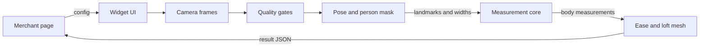

# Tailor Scan — product and engineering plan

Status: Milestone 4 adds the capture flow (consent, setup, prompts, and manual entry). Pose, frame quality, and measurement math are not built yet.

This document locks the MVP baseline. Later milestones should change a decision only when a tape-measure check or an integration review gives a reason, and the change should be recorded here.

Tailor Scan is a camera widget a shop can embed in a page. The customer stands in front of their laptop or phone, follows two posed captures, and the page receives chest, waist, sleeve length, and garment length in centimeters, each with a range. The customer or the tailor then adds ease for a fitted, regular, or relaxed garment. Video is processed in the browser and is discarded. The shop’s page receives numbers, not pictures.

## 1. Product boundary

The MVP is one widget and one demo page that embeds it.

In scope:

- Guided front and side capture, plus a manual-entry fallback so an order can still be placed when the camera path fails.
- Four tailor measurements, defined in section 2.
- Height calibration, with an in-frame A4 reference as a cross-check and a manual known-rectangle tool that includes a credit-card preset.
- An expected range on every camera measurement, and copy that distinguishes a size suggestion from a cutting measurement.
- Fitted / regular / relaxed ease, shown on a simple 3D loft the user can orbit.
- Three ways to embed: a script snippet, a web component, and an iframe. All three emit the same JSON.

Out of scope for the MVP:

- Accounts, a database, checkout, order management, or any Tailor Scan backend.
- Cloth simulation, virtual try-on, and a scanned body mesh.
- Further tailor measures (collar, cuff, shoulder width, hip girth, arm girth). Hip width is used internally so the preview mesh has a plausible silhouette, and it is not a customer-facing measurement.
- Multi-person scenes, children, and measurement of anyone under 18.
- Accuracy claims in the UI. Ranges shown before the validation milestone are error-budget ranges, labeled as estimates.

The merchant’s site owns what happens after `complete`: saving the order, emailing a tailor, or mapping the numbers onto a size chart. The widget can accept a size chart and return overlapping sizes. It does not pick a single size when the range covers more than one.

## 2. Measurement definitions

South Asian tailoring shops do not all place the tape in the same spot. The widget must name its tape path, draw it, and let the embedder switch the two definitions that actually change the number. A geometric error of 2 cm is smaller than a definition error of half a shoulder width.

MediaPipe Pose Landmarker indices used below: shoulders 11 and 12, elbows 13 and 14, wrists 15 and 16, hips 23 and 24, knees 25 and 26, ankles 27 and 28, heels 29 and 30, nose 0, ears 7 and 8.

| Id | Words customers use | Tape path the MVP measures | ISO 8559-1 analogue |
| --- | --- | --- | --- |
| `chhati` | Chhati, chest, bust | Horizontal girth at the fullest torso section in the chest band, arms held away from the body, relaxed breath | Chest girth, or bust girth when that is the fullest section |
| `kamar` | Kamar, waist | Horizontal girth at the narrowest torso section in the natural-waist band | Waist girth |
| `baazu` | Baazu, sleeve, arm | Default: shoulder landmark to wrist landmark via the elbow. Alternate config `sleevePath: "nape-to-wrist"` continues the path from the nape proxy across the shoulder | Arm length; the nape path matches how many jacket and kurta cutters measure a sleeve |
| `lambai` | Lambai, length | Back length from the nape proxy down to a hem anchor. Anchors: hip, knee, ankle, or a centimeter offset the user sets. Defaults: hip for `shirt`, knee for `kurta` and `kameez` | Back waist length is a different, shorter measure. Lambai here is garment length, not that ISO measure |

Nape proxy: midpoint of the two shoulder landmarks, shifted up by 15% of the shoulder-to-shoulder distance. It is an approximation of the base of the neck, and the review screen draws it. Front length, which tailors often take 1–2 cm shorter than the back, waits until the back length is validated.

Left and right sleeve are both returned. The headline `baazu` follows `sleeveAggregate`: `mean` (default) or `max`. A difference above 3 cm widens the range and shows both sides, because the cause may be pose rather than a real difference.

Body numbers and garment numbers stay separate. Ease is never folded into the body value.

## 3. Architecture



Three packages, one workspace:

| Package | Responsibility |
| --- | --- |
| `packages/core` | Types, JSON Schema, centimeters and inches, ellipse girth, scale, station selection, ease, size-chart overlap. No DOM, no WASM, no network. |
| `packages/widget` | Capture UI, camera, MediaPipe adapters, embed shells. Depends on `core` through a `VisionProvider` interface so tests can feed fixtures. |
| `apps/demo` | Static host used as the integration fixture. Loads the widget as a custom element and inside an iframe, and prints the JSON it receives. |

Frames stay in memory. The core module sees numbers: landmark coordinates, a scale, and two widths per station. It does not see pixels. That split is what makes the math reviewable without a camera, and it is what the privacy test depends on.

Runtime shape:

1. The host creates a session (script API, custom element, or iframe `postMessage`).
2. The widget asks for consent, then for height, garment, and units.
3. `getUserMedia` previews the camera. A guide loop runs pose at a modest rate.
4. When the gates hold, the widget keeps a short burst, runs the heavier pose pass and the mask, and reduces the burst to one averaged sample per view.
5. Core calibrates scale, estimates the four measurements, and attaches ranges.
6. The review step lazy-loads a small Three.js scene and applies ease.
7. Confirm posts the result to the host. Closing the session stops the camera and drops the frames.

There is no Tailor Scan server in this path. Model files and WASM are static downloads. They contain no customer data.

### Vision provider

```ts
interface VisionSample {
  landmarks: Landmark[]      // 33 image points, normalized
  worldLandmarks: Landmark[] // 33 hip-centered points, model meters
  mask: { width: number; height: number; person: Uint8Array }
  imageWidth: number
  imageHeight: number
}

interface VisionProvider {
  load(): Promise<void>
  sample(frame: CanvasImageSource, timestampMs: number): Promise<VisionSample>
  close(): void
}
```

The MediaPipe implementation is one provider. Unit tests and the demo’s “replay fixture” button use another. UI code calls the interface only.

## 4. Guided capture

The customer should be able to finish without a tailor present. A second person holding the phone is the easier path and is offered first. Self-capture uses a prop-and-timer path.

### Steps

1. **Consent.** Plain language: the camera stays on this device, pictures are not uploaded, the shop receives measurements if the customer confirms. Decline ends the session with `cancel`. The consent control is off until the short text is on screen. No pre-ticked box.
2. **Order setup.** Garment preset (`shirt`, `kurta`, `kameez`, `custom`), display units, optional size chart. Age gate: the copy says the tool is for adults. This is a declaration, not an identity check.
3. **Body setup.** Standing height in centimeters or feet and inches, as they are dressed now, including shoes if they will wear them on camera. Clothing: close-fitting t-shirt and trousers, hair tied up, pockets empty, dupatta and open jacket removed. A single question, “Are these clothes close-fitting?”, stored as `clothingFit: "close" | "loose" | "unknown"`. Loose does not block the flow. It caps confidence and widens girth ranges.
4. **Camera.** Permission prompt, then a live preview. If permission is denied, show how to re-enable it and offer manual entry. Microphone is never requested.
5. **Position coach.** Chips for light, full body, stillness, and distance. The customer steps back until head and feet are both inside the frame with margin. Phone copy: prop the phone at about navel height, lens level, about 2 to 3 meters away. Laptop copy: raise the lid on books so the lens is not looking up from the desk.
6. **Front pose.** Arms about 20–30° away from the torso, elbows soft, feet about hip-width, weight even, normal breathing. A countdown starts after the gates have been green for about one second, then a burst of roughly 15 accepted frames.
7. **Turn.** “Turn to your left until you are side-on.” The gate compares shoulder width with the front view so a half-turn does not pass.
8. **Side pose.** Same hold and burst. Arms stay slightly forward of the torso so the chest depth is visible and the arm does not hide the waist.
9. **Reference, if used.** The A4 sheet is already in the front frame (taped on the wall beside the thigh, or held flat against the thigh). This step only confirms the detection and lets the customer drag corners if it failed. It is not a separate close-up.
10. **Review.** Tape-path diagram, body value, expected range, confidence, and a numeric override on each measurement.
11. **Drape.** Preset and sliders. Body, ease, and garment columns. Orbit the loft.
12. **Confirm.** `complete` fires. The camera light goes off before the event.

Manual entry is available from the camera step onward and skips to review with `source: "user"`.

### Prompts

Prompts are short, present tense, and tied to a failing gate. Examples:

- “Step back until your head and feet are both in frame.”
- “Hold still.”
- “Move your arms a little away from your sides.”
- “Turn further until your chest points to the side.”
- “The light is low. Face a window.”
- “We can’t separate your shirt from your body. A closer-fitting top will tighten the range.”

Each prompt exists as text. Color is not the only signal. A single optional click announces the next step for screen-reader users. The guide animation respects `prefers-reduced-motion`.

### Why these poses

Girth needs a width and a depth at the same station. The front frame supplies width. The side frame supplies depth. Arms leave the silhouette so the torso edge is the body, or close to it. A relaxed stance matches how a tailor asks a customer to stand. A strict T-pose is a worse match for home capture and for sleeve length.

One view is allowed. Front-only girth uses a depth prior and a much wider range, and the copy says a side photo would tighten it. Sleeve and length can still come from the front.

## 5. Quality checks

Gates are pure functions over a sample, so they can be tuned against fixtures. Starting thresholds below are initial values for the pose milestone, not clinical cutoffs.

| Check | Pass | Fail behavior |
| --- | --- | --- |
| Required landmarks visible | Visibility ≥ 0.6 on shoulders, elbows, wrists, hips, knees, ankles or heels, nose, ears | Block the burst and name the missing part |
| Full body | Crown and heels inside the frame; body height between 55% and 90% of the image | Prompt to step back or closer |
| Stillness | Landmark motion under 2% of body height across the burst window | “Hold still”; discard the burst |
| Exposure | Mean luma roughly 40–210 on an 8-bit frame | Prompt about light |
| Blur | Variance of Laplacian above a resolution-specific floor, set from fixtures | Discard the frame |
| Front arms | Upper arm 15–45° from the torso | Prompt to move arms out; block girth if under 15° |
| Side turn | Shoulder pixel width under 35% of the front shoulder width | Prompt to turn further |
| Mask usable | Person mask touches crown and feet and is one component | Retake; fall back to landmark widths with a wider range |
| Left/right sleeve | Absolute difference ≤ 3 cm after scaling | Return both, widen the range |
| Scale agreement | Height scale and A4 scale within 3% | Apply the rule in section 6 |

The burst keeps frames that pass visibility, blur, and stillness, then averages landmark positions. Girth uses the mask from the sharpest kept frame, at the averaged station fraction, so a single blurry edge does not set the chest.

Soft warnings that do not block: busy background, `clothingFit: "loose"`, height-only scale, wide-angle selfie camera with the body filling the frame. Each warning is stored on the result and mapped to extra range.

## 6. How measurements are calculated

### 6.1 Scale

MediaPipe world landmarks are hip-centered coordinates in meters. That meter scale is the pose model’s estimate, and published checks show it moves with viewpoint. Tailor Scan treats world coordinates as a shape and a direction, and takes real scale from the customer’s height, checked against an object in the same frame when one is present.

**Height scale, required.**

1. Crown: the top of the person mask above the nose, inside a horizontal window around the ears. Reject a crown whose distance to the nose is outside about 8–16 cm once a first scale exists, and ask the customer to drag the crown marker. Hats and high buns fail this on purpose.
2. Floor contact: the lower heel landmark. If both heels are weak, use the ankle and add 7 cm, and lower calibration confidence.
3. `scaleCmPerPx = enteredHeightCm / (heelY - crownY)`.
4. Each view gets its own scale. The customer may stand at a different distance after they turn. Mixing pixels from the two views is not valid.

Entered height must match the stance on camera, shoes included. A remembered barefoot clinic height while wearing shoes is a direct scale error, and the setup step says so.

**A4 reference, optional cross-check.**

A blank sheet in a real room is a weak detector: doors, posters, and laptop lids are also rectangles. The widget generates a one-page PDF the customer prints at 100% scale. The known object is an inner rectangle of **180 mm by 260 mm**, inset from the paper edge so printer margins do not change the measure. “Fit to page” is called out on the sheet because it silently scales the page.

Automatic detection looks for that high-contrast rectangle in the front frame, at an aspect ratio of 260/180 within 8%, with its long edge at least about 12% of body height in pixels. The sheet has to sit beside the legs or against the thigh, inside the body vertical span. A sheet held toward the lens fails that coplanar check.

**Credit card and other objects.**

ISO/IEC 7810 ID-1 is 85.60 mm by 53.98 mm. At a full-body distance that card is only a few dozen pixels wide, which is not enough for a 1% scale. A close-up of the card cannot scale a later full-body frame, because the customer has moved. The card is a preset in the manual tool: the customer drags four corners around an object that is in the full-body frame and at the body’s depth, and enters its size (A4 inner rectangle, credit card, or custom). The UI says a card only helps when it appears large and next to the body. It is not the primary path.

**Which scale wins.**

| Situation | Scale used | Calibration confidence |
| --- | --- | --- |
| Height only | Height | Medium, and girth ranges stay wide |
| Height and A4 agree within 3% | Average of the two | High |
| They disagree, and the sheet passes the coplanar checks | A4 | Medium; copy says the entered height may be off |
| They disagree, and the sheet fails those checks | Height | Medium; the sheet is ignored and the customer can drag corners |

### 6.2 Stations for chest and waist

Stations are fractions of the shoulder-midpoint to hip-midpoint segment, so a front view and a side view taken at different distances still match.

- Chest band: 20–40% of the way from shoulders to hips. Choose the row of maximum torso width after the arms are removed. That follows the fullest part, which is what a tailor’s tape does for chhati.
- Waist band: 55–78% of the same segment. Choose the narrowest row. If the minimum sits on the band edge, lower confidence; the band probably missed the waist or the shirt did.

The side view is measured at the same fractions. Front scale converts width to centimeters. Side scale converts depth to centimeters.

**Arm removal.** Build a polygon along shoulder–elbow–wrist for each arm. The half-width is the robust minimum of the mask thickness perpendicular to the upper arm, clamped to roughly 4–10 cm. Subtract those polygons from the person mask before the width scan. If the arm angle is under 15°, skip girth and ask for a retake.

Pose Landmarker can emit a person mask with the landmarks. Use that mask first: it is trained on full bodies at a few meters. The selfie segmenter is aimed at people close to the camera, so it is a fallback if the pose mask’s edges prove too coarse in the silhouette milestone, not the default.

### 6.3 Chhati and kamar

Model the cross-section as an ellipse with semi-axes `a = widthCm / 2` and `b = depthCm / 2`. Use Ramanujan’s second approximation:

```text
h = ((a - b) / (a + b))^2
C = π (a + b) (1 + 3h / (10 + sqrt(4 - 3h)))
```

The ellipse formula itself is accurate for ellipses. People are not ellipses. That model mismatch is a few centimeters and is included in the range as a floor, larger for chest than for waist, and larger again when the customer said the clothes were loose.

Front-only fallback, when the side view is skipped: `b = a * prior`, with starting priors 0.70 for chest and 0.75 for waist. Those priors are placeholders until the validation set replaces them. Method id: `ellipse-front-only`. Add 4 cm to the girth range.

Sanity flags, which widen confidence and never silently clamp the number:

- Chest outside 60–160 cm.
- Waist greater than chest by more than 10 cm (the station may have landed on the hip).
- Side depth greater than front width (likely a bad turn or a bent arm).

### 6.4 Baazu

Primary length: scale the pose model’s 3D arm bones by the height calibration.

```text
metricScale = enteredHeightCm / worldStatureCm
baazuCm = (worldLength(shoulder, elbow) + worldLength(elbow, wrist)) * metricScale
```

`worldStatureCm` uses the same crown and heel as the height scale, with the crown placed in world space so that the crown-to-nose distance matches the front-view measurement. World landmarks contribute direction and bone proportions. They do not contribute meters.

Cross-check: when the arm’s world depth is small, the arm is nearly in the image plane, and the 2D pixel path times `scaleCmPerPx` is the better observation. If the 2D and 3D lengths differ by more than 4 cm, prefer the in-plane 2D length and lower confidence. If the arm is clearly out of plane, keep the scaled 3D length and widen the range. The pose model pulls unusual limb proportions toward average, so very long or very short arms are a known weak case; the in-plane cross-check exists for that reason.

`nape-to-wrist` adds the distance from the nape proxy to the shoulder landmark before the arm path. The review diagram changes with the config so the tailor sees which path they will cut from.

### 6.5 Lambai

Lambai is a garment length anchored to the body, not a body girth the camera can “see.” The customer is usually not wearing the finished hem.

```text
lambaiCm = (hemY - napeY) * frontScaleCmPerPx + ease.lengthCm
```

Hem Y comes from the hip, knee, or ankle landmarks, or from a centimeter slider initialized at the garment default. The camera’s job is the scale and the anchor. The slider’s job is the style. The result records `lengthAnchor` and `hemAnchor` so a tailor knows what the number means.

### 6.6 Range

Each camera measurement carries an 80% expected range built from an error budget, not from a model score. MediaPipe’s visibility value is a gate input. It is not the centimeter range.

| Contributor | How it enters the range |
| --- | --- |
| Scale | ±2–3% of the value for height-only; toward ±1% when height and A4 agree |
| Station | ±1 cm of girth, more if the chosen row is on the band edge |
| Mask edge and clothes | ±1 cm of diameter when clothes are close-fitting; a +3 cm systematic widening when clothes are loose or unknown |
| Ellipse mismatch | 2.5 cm floor on chest, 2 cm floor on waist |
| Breath | 1.5 cm on chest |
| Sleeve foreshortening | 1.5 cm when the in-plane check agrees; 3 cm when it does not |
| Length anchor | 1.5 cm, plus the slider step of 0.5 cm |

Add independent contributions in quadrature, then add clothing bias as a one-sided widening. Round the displayed value and the range ends to 0.5 cm. Wire values keep one decimal so hosts can sum ease without jumping half-centimeters twice.

These widths are the pre-validation budget. After the tape-measure milestone, replace them with measured percentiles and change the label from “expected range” to the percentile that was actually measured. Until then the UI and the JSON field `rangeBasis` say `error-budget`.

## 7. Accuracy limits and how to say them

A phone photo does not replace a tailor’s tape for a fitted garment. It can start a remote order, especially for garments that already include a lot of ease.

What published work supports:

- A controlled two-view ellipse pipeline, with calibration and marker correction, reported about ±1 cm average difference against tape on upper-body girths for 78 women ([Simple Hybrid Camera-Based System Using Two Views for Three-Dimensional Body Measurements](https://www.mdpi.com/2073-8994/16/1/49), *Symmetry* 2024). That setup is a lab ceiling for this geometry. It is the reason the MVP uses two views and an ellipse. It is not a promise for a self-serve living room.
- The same paper cites roughly 1–3 cm of variation for repeated manual tape measurements. Matching a careful tape more tightly than that, in a home, is the wrong goal.
- A 2026 weak-calibration study ([arXiv:2601.01639](https://arxiv.org/html/2601.01639)) found a side silhouette plus an ellipse more reliable for waist than pose-only regression, and found loose clothing systematically inflating the waist. Its sample is small. The qualitative lesson is the one we ship: clothes and a real side view dominate girth error.
- MediaPipe’s own world landmarks are real-world coordinates in meters with the origin at the hip midpoint ([Pose Landmarker](https://developers.google.com/edge/mediapipe/solutions/vision/pose_landmarker)). Independent checks show that scale and joint error depend strongly on camera angle. We use those points for pose and bone direction, and we calibrate scale ourselves.

Targets for the validation milestone, home capture, close-fitting clothes, both views, height entered honestly:

| Measurement | Mean absolute error to aim for | Share of cases to aim for |
| --- | --- | --- |
| Baazu, lambai | under 2.5 cm | 80% within 4 cm |
| Chhati, kamar | under 4 cm | 80% within 6 cm |

A second-person capture, plain wall, printed sheet, and draggable markers should do better. The lab literature suggests girths can approach 2 cm mean error there, sometimes about 1 cm. The product does not advertise that figure unless our own study measures it.

Where the error goes in practice:

- Wrong height, shoes forgotten, or a tilted camera scales every measurement.
- Loose cloth adds to girth and does not average out.
- A missed side view leaves depth as a population prior.
- Sleeve error grows when the arm points at the camera.
- Lambai error is mostly the hem choice and the nape proxy, which the diagram is there to make obvious.
- Wide-angle front cameras stretch edges. Keeping the body centered and inside the frame-height band is the mitigation in the MVP. A lens model waits until validation shows residual edge bias.

**Copy rules**

- Show the range next to the value. A chest estimate is “96 cm, expected 91–101 cm”, with `rangeBasis` visible in the details.
- Round to 0.5 cm or ¼ inch. Never show 96.37.
- Keep three sentences available and use the one that matches confidence: a high-confidence result can suggest a size band; a medium result asks for a side view or a retake; a low result says it is a starting point and a tailor should measure before cutting a fitted garment.
- Ready-to-wear grades are often about 4 cm on the chest. If the range overlaps more than one merchant size, return every overlapping size. Do not collapse them.
- The word “scan” in marketing copy is always paired with “estimate.” The review screen heading is “Estimated measurements.”

## 8. Privacy

Processing is on-device. The widget has no upload API, no `MediaRecorder`, and no code path that posts a frame, a mask, or a face crop.

| Data | Leaves the device by default |
| --- | --- |
| Video, stills, masks, face crops | No. Not stored and not sent. |
| Model weights and WASM | Downloaded from the widget origin. They are not customer data. |
| Measurement JSON, ease, quality warnings | Yes, to the host page, only after the customer confirms. |
| Normalized landmarks | Only when the embedder sets `exportKeypoints: true`. Off by default. |
| Analytics | None in the widget. |

The host page is then free to post that JSON to the merchant’s server. That hop is the merchant’s. Integrator docs say so, and they ask the merchant to name it in their privacy notice.

Consequences for the build:

- Self-host a pinned Pose Landmarker `.task` file and the tasks-vision WASM. The bundle must not load `@latest` from a third-party CDN at runtime.
- Network allowlist during a session: the script, the WASM, the model, and the optional calibration PDF. The privacy milestone fails the demo if any other request, or any POST, occurs.
- HTTPS, because `getUserMedia` requires a secure context. Camera permission only.
- Iframe embed uses `allow="camera"` on the widget origin. The widget `postMessage`s only to the configured target origin. The host ignores messages from any other origin.
- Face landmarks exist inside the pose model. The widget does not draw a face mesh, does not export the face box, and offers a preview blur over the head region that never leaves the canvas.
- `rememberLocally` defaults to false. When a host turns it on, the last result JSON is stored in `localStorage` on the customer’s device under a documented key.
- Session end and the pagehide event stop the tracks and drop references to frames and masks.

Body measurements are personal data once a shop stores them. Video of a body can also be biometric data when it is used to identify someone. The widget’s mitigation is that it never receives or keeps the video. The merchant is the controller for the JSON they choose to store. The consent step is mandatory before the camera starts. The MVP is for adults.

A short integrator checklist ships in the demo README at the privacy milestone: consent, purpose limitation, retention, no resale of measurements, and a way for the customer to submit manual numbers instead of using the camera.

## 9. Embed API

One result schema, three shells. The iframe is the default recommendation for a third-party shop, because the camera permission and the script run on the widget origin. The custom element and the script API are for shops that want the UI in their own page and accept that the script runs in their origin.

### Script

```html
<div id="tailor-scan"></div>
<script src="https://cdn.example.com/tailor-scan.js" integrity="sha384-…" crossorigin="anonymous"></script>
<script>
  const session = TailorScan.open({
    target: "#tailor-scan",
    presentation: "inline", // or "modal"
    displayUnits: "cm",     // "cm" | "in"
    garment: "kurta",       // "shirt" | "kurta" | "kameez" | "custom"
    sleevePath: "shoulder-to-wrist",
    sleeveAggregate: "mean",
    lengthAnchor: "nape",
    hemAnchor: "knee",
    calibration: "both",    // "height" | "reference" | "both"
    exportKeypoints: false,
    blockOnLowConfidence: false,
    locale: "en",
    theme: { accent: "#1f3a34" },
    sizeChart: [],
    easePresets: null,      // null uses built-in defaults
    onReady: () => {},
    onProgress: (state) => {},
    onComplete: (result) => {},
    onCancel: () => {},
    onError: (error) => {}
  })
</script>
```

`session.close()` stops the camera. `session.setDisplayUnits("in")` changes display only.

### Web component

```html
<tailor-scan
  display-units="cm"
  garment="kurta"
  calibration="both"
></tailor-scan>
<script>
  const el = document.querySelector("tailor-scan")
  el.config = { /* same options, without target */ }
  el.addEventListener("complete", (event) => {
    console.log(event.detail)
  })
</script>
```

Events: `ready`, `progress`, `complete`, `cancel`, `error`. The element uses shadow DOM so shop CSS does not restyle the capture UI. `theme.accent` is the supported brand hook in the MVP.

### Iframe

```html
<iframe
  title="Tailor Scan"
  src="https://scan.example.com/embed?session=…"
  allow="camera https://scan.example.com"
  style="width: 100%; height: 720px; border: 0"
></iframe>
```

The host sends `{ source: "tailor-scan-host", version: 1, sessionId, type: "init", config }`. The widget replies with `{ source: "tailor-scan", version: 1, sessionId, type, payload }` where `type` is `ready`, `progress`, `complete`, `cancel`, or `error`. Both sides check `event.origin`. `sessionId` is required so a page with two embeds does not cross wires.

### Result schema `tailor-scan.result.v1`

Canonical numbers are centimeters. `displayUnits` tells the host how the customer was viewing them. Inches = centimeters / 2.54, displayed to the nearest ¼ inch. A manual entry has no pixel scale, so `frontScaleCmPerPx` and `sideScaleCmPerPx` are null and `agreement` is `height-only`.

```json
{
  "schema": "tailor-scan.result.v1",
  "sessionId": "8f0c",
  "capturedAt": "2026-10-13T14:00:00.000Z",
  "displayUnits": "cm",
  "garment": "kurta",
  "subject": {
    "heightCm": 172,
    "clothingFit": "close",
    "adultDeclaration": true
  },
  "calibration": {
    "method": "height+a4",
    "frontScaleCmPerPx": 0.21,
    "sideScaleCmPerPx": 0.2,
    "agreement": "within-3pct",
    "confidence": "high"
  },
  "measurements": [
    {
      "id": "chhati",
      "label": "Chhati",
      "source": "camera",
      "method": "ellipse-two-view",
      "valueCm": 96.4,
      "rangeCm": [91.5, 101.5],
      "rangeBasis": "error-budget",
      "confidence": "medium",
      "stationFraction": 0.31,
      "overrideCm": null
    },
    {
      "id": "kamar",
      "label": "Kamar",
      "source": "camera",
      "method": "ellipse-two-view",
      "valueCm": 84.0,
      "rangeCm": [79.5, 89.0],
      "rangeBasis": "error-budget",
      "confidence": "medium",
      "stationFraction": 0.66,
      "overrideCm": null
    },
    {
      "id": "baazu",
      "label": "Baazu",
      "source": "camera",
      "method": "scaled-world-bones",
      "sleevePath": "shoulder-to-wrist",
      "valueCm": 63.5,
      "rangeCm": [61.0, 66.0],
      "rangeBasis": "error-budget",
      "confidence": "high",
      "leftCm": 63.0,
      "rightCm": 64.0,
      "overrideCm": null
    },
    {
      "id": "lambai",
      "label": "Lambai",
      "source": "camera",
      "method": "nape-to-hem",
      "lengthAnchor": "nape",
      "hemAnchor": "knee",
      "valueCm": 102.0,
      "rangeCm": [99.5, 104.5],
      "rangeBasis": "error-budget",
      "confidence": "high",
      "overrideCm": null
    }
  ],
  "fit": {
    "preset": "regular",
    "easeChestCm": 14,
    "easeWaistCm": 16,
    "sleeveLengthDeltaCm": 1,
    "garmentLengthDeltaCm": 0,
    "flare": "straight"
  },
  "garmentMeasurements": {
    "chhatiCm": 110.4,
    "kamarCm": 100.0,
    "baazuCm": 64.5,
    "lambaiCm": 102.0
  },
  "sizes": [],
  "quality": {
    "front": "pass",
    "side": "pass",
    "warnings": []
  },
  "privacy": {
    "imagesLeftDevice": false,
    "keypointsIncluded": false
  }
}
```

`source` is `camera`, `user`, or `camera+override`. An override replaces the value used for garment math and is stored in `overrideCm`. The camera estimate stays in `valueCm`. `method` for a skipped side view is `ellipse-front-only`. `sizes` lists every merchant size whose interval overlaps `rangeCm`, when a chart was provided.

`onError` codes: `camera-denied`, `camera-missing`, `model-load-failed`, `unsupported-browser`, `session-superseded`. Model load failure offers a retry and the manual path.

JSON Schema for this document lives in `packages/core` and is validated in unit tests from the contract milestone onward. Breaking changes require a new `schema` string.

## 10. Fit and drape

The adjustment layer adds ease. It does not refit a cloth simulation, and it does not change the camera estimate.

```ts
type FitPreference = {
  preset: "fitted" | "regular" | "relaxed" | "custom"
  easeChestCm: number
  easeWaistCm: number
  sleeveLengthDeltaCm: number
  garmentLengthDeltaCm: number
  flare: "none" | "straight" | "aline"
}
```

Garment value = body value used for cutting (override if present, otherwise estimate) + the matching ease. Sleeve ease here is a small length change. Girth ease is circumference. Flare affects the preview hem and is recorded for the tailor; it does not invent a fifth measurement.

Built-in presets are starting points a shop can replace with `easePresets`. They are wearing ease plus a simple style ease, not a national standard.

| Garment | Preset | Chest | Waist | Sleeve length | Garment length |
| --- | --- | --- | --- | --- | --- |
| Kurta, kameez | Fitted | +8 | +8 | +0.5 | 0 |
| Kurta, kameez | Regular | +14 | +16 | +1 | 0 |
| Kurta, kameez | Relaxed | +20 | +24 | +1.5 | +2 |
| Shirt | Fitted | +6 | +6 | 0 | 0 |
| Shirt | Regular | +10 | +12 | +0.5 | 0 |
| Shirt | Relaxed | +16 | +18 | +1 | +1 |

Slider limits default to 0–30 cm of girth ease, −2–4 cm of sleeve length, and −4–15 cm of garment length. `easeLimits` in config can tighten them. Moving a slider sets the preset to `custom`.

The mesh is a loft of elliptical rings at neck, chest, waist, hip, and hem. Chest and waist rings use the measured width and depth. The hip ring uses the internal hip silhouette so the torso does not collapse. Ease scales the chest and waist circumferences. `aline` grows the hem ring only. Each sleeve is a tapered tube from shoulder to elbow to wrist; sleeve-length ease extends it. The customer can orbit the loft. There is no cloth solver and no collision.

The review layout always shows three columns: Body, Ease, Garment. A tailor reading only the garment column still has the ease beside it.

## 11. Tech stack

| Choice | Why |
| --- | --- |
| TypeScript, npm workspaces | Shared types between core and widget. One language for the embed and the demo. |
| `packages/core` with Vitest | Girth, scale, and ease are the product. They need golden tests that do not boot a camera. |
| Vite library build for the widget | Emits an ES module and a single IIFE for the script tag. Fast dev server for the demo. |
| Preact inside shadow DOM | The capture flow has enough UI to want components, and Preact does not collide with a shop that already uses React. Shadow DOM keeps shop CSS out. |
| MediaPipe Tasks Vision, Pose Landmarker | Current on-device pose API, with image landmarks, world landmarks, and an optional person mask. Runs in WASM and WebGL. Heavy model for the capture burst; Full model for the live guide if Heavy misses the frame budget on a mid-range phone. Legacy Holistic is the older API and is not the one we build on. |
| Pinned, self-hosted `.task` and WASM | Reproducible builds and a privacy story that does not depend on a public CDN at runtime. |
| Canvas 2D for the camera overlay | Skeleton, station lines, and the crown handle during capture. |
| Three.js, lazy-loaded on the review step | The drape control needs a real mesh the customer can orbit. Keeping it out of the capture bundle protects time-to-guidance. |
| Demo as a Vite app, not Next.js | The product is a library plus a static host. Server rendering does not help a camera widget. |
| JSON Schema 2020-12 and Ajv | The embed contract is tested, not implied by TypeScript alone. |
| Playwright later, with a fake video device | One smoke test that the demo receives a fixture result. Not a substitute for the core tests. |

Browser target: current Chrome and Edge, Firefox, and Safari 17 or newer, desktop and mobile. iOS Safari is the risk; the pose provider must fall back from the GPU delegate to the CPU delegate. The guide loop should stay near 15 fps on a 2022 phone. The widget script, excluding models and Three.js, should stay under about 200 KB gzipped. Models download once and are cached.

No database and no application server. The demo’s dev server is enough.

## 12. Milestones

Each milestone is one pull request, reviewable on its own. The demo stays runnable after every PR. Dependencies are linear except where noted.

### PR 1 — Scaffold

Workspace, TypeScript, Vitest, ESLint, Vite library package that defines a placeholder `<tailor-scan>` element, and a demo page that mounts it. README run instructions for the demo. No camera and no math yet.

Review: `npm test` and `npm run dev` in the demo; the page shows the placeholder.

### PR 2 — Contract and units

Result types, JSON Schema, centimeter/inch conversion, ease addition, size-chart overlap, and fixture JSON valid against the schema. Still no camera.

Review: schema tests, including a rejected payload with an unknown `schema` string. Depends on PR 1.

### PR 3 — Embed shells with a mock result

`TailorScan.open`, the custom element, and the iframe protocol with origin checks and `sessionId`. The demo completes a fake session and prints the mock JSON from both the inline element and the iframe.

Review: a test page that refuses a message from the wrong origin. Depends on PR 2.

### PR 4 — Capture flow without vision

State machine, consent, setup forms, prompts, manual-entry path, desktop and narrow layouts, reduced motion. Camera preview can be behind the permission prompt, with a “continue without camera” path.

Review: click through consent → setup → manual complete, and confirm the demo receives `source: "user"`. Depends on PR 3.

### PR 5 — Frame quality gates

Blur, exposure, framing, and stillness as pure functions, plus live chips on the preview. Thresholds live next to their fixtures.

Review: fixture images or synthetic frames that pass and fail each gate. Depends on PR 4. Can be developed beside PR 6 once the provider interface from the plan is stubbed.

### PR 6 — Pose guidance

MediaPipe provider, self-hosted model, front and side templates, skeleton overlay, burst averaging, GPU-to-CPU fallback. Progression waits on the pose gates.

Review: demo against a recorded fixture and a live laptop check; model URL is local; denying the camera still reaches manual entry. Depends on PR 4 and PR 5.

### PR 7 — Silhouette and stations

Person mask, arm removal, chest and waist fractions, station lines drawn on the preview. Front-only path remains available.

Review: fixtures with arms down (girth blocked) and arms out (stations land in the bands). Depends on PR 6.

### PR 8 — Calibration

Height scale, crown and heel selection, printable A4 PDF, rectangle detection, corner dragging, credit-card preset on the manual rectangle, and the agreement rule.

Review: synthetic scenes with a known pixel height and a known rectangle, including a sheet that is too close to the camera and is rejected. Depends on PR 7 for the mask, and the scale math can land in `core` earlier, beside PR 2.

### PR 9 — Measurement engine

Chhati, kamar, baazu, lambai, ranges, left/right sleeve, and the front-only prior. Golden tests from hand-built landmarks and widths.

Review: a known ellipse matches Ramanujan; a 2% height error scales lengths by 2%; loose clothing widens girth on one side; in-plane and out-of-plane sleeves pick the documented method. Depends on PR 2. Integration with the camera depends on PR 8.

### PR 10 — Review, override, and drape

Tape-path diagrams, ranges, unit toggle, overrides, presets, sliders, body/ease/garment columns, lazy Three.js loft.

Review: slider changes move only the garment column and the mesh; an override survives a preset change; display inches still emit centimeters on the wire. Depends on PR 9 and the capture UI.

### PR 11 — Privacy and integrator hardening

Network allowlist test, session teardown, face-blur preview, SRI note, integrator checklist, error codes, `exportKeypoints` default off.

Review: demo run shows only model, WASM, script, and PDF requests, and no POST. Unplug the camera mid-flow and confirm the tracks stop. Depends on PR 3 through PR 10.

### PR 12 — Validation protocol and disclaimer lock

A session sheet for paired tape measurements (same definitions as section 2), a folder format for those sessions, and a script that reports mean absolute error and the 80th percentile against the targets in section 7. The UI keeps `rangeBasis: "error-budget"` and the estimate heading until a study file is deliberately checked in. Checking in a study is a separate, explicit change.

Review: the script reproduces a hand-computed error on a three-row fixture. This PR does not claim the targets have been met. Depends on PR 9.

PR 12 can be written as soon as PR 9 exists. It should land before any public accuracy sentence.

## 13. Risks

| Risk | What we will do |
| --- | --- |
| iOS Safari is slow or fails the GPU delegate | CPU fallback, and a device check in PR 6 before adding more vision work |
| Pose mask is too coarse for girth | Add the square selfie segmenter in a follow-up, compared on the same fixtures |
| Blank-room rectangle false positives | Printed inner rectangle, plus corner dragging |
| Mean-shape bias on unusual arms | In-plane 2D cross-check and a wide range when they disagree |
| Loose kurta, dupatta, long hair, hijab over the torso | Gates and the clothing question fail open with a wide range, and the copy asks for a closer-fitting layer where the customer can wear one |
| Darker skin and dim rooms drop landmarks | Fixtures and a live test set that include them before PR 6 is called done |
| Shops will quote the number as a finished tape measure | Range, estimate heading, and size overlap are part of the contract, not polish |
| Definition mismatch across regions | `sleevePath`, hem anchor, and the on-screen tape diagram |

## 14. MVP is done when

- A shop can add the iframe or the script to a static page using the README from PR 11.
- An adult customer can complete front and side capture on a phone-sized screen and on a laptop, or finish by typing the four numbers.
- The page receives `tailor-scan.result.v1` in centimeters, with ranges, ease, and garment values.
- The drape controls change the garment column and the loft and leave the body column in place.
- A test shows that the widget sent no image and no POST.
- Core math is covered by the golden tests in PR 9.
- The UI calls the numbers estimates and shows budgeted ranges, until a real tape study replaces the budget.
